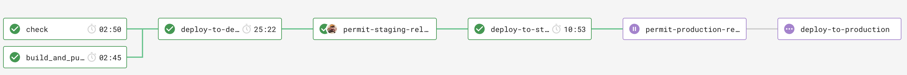

# Contributing to Tenure Information API

## Prerequisites

- .NET SDK 10
- Docker with Docker Compose
- A `LBHPACKAGESTOKEN` environment variable that can read the Hackney GitHub NuGet feed (see `nuget.config`)

## Local dependencies

`docker-compose.yml` defines:

| Service | Port | Notes |
| --- | --- | --- |
| `dynamodb-database` | 8000 | `amazon/dynamodb-local` |
| `localstack-tenure-information-api` | 4566 | `localstack/localstack:0.14.1` with `SERVICES=sns,sqs` |
| `tenure-information-api` | 3000 | The API, built from `TenureInformationApi/Dockerfile` |
| `tenure-information-api-test` | n/a | The test runner, built from `TenureInformationApi.Tests/Dockerfile` (also runs SonarScanner) |

## Build and run

```sh
make build   # docker compose build tenure-information-api
make serve   # build, then docker compose up tenure-information-api (http://localhost:3000)
```

To run from an IDE, start DynamoDB and LocalStack first. Then set `DynamoDb_LocalMode=true`, `DynamoDb_LocalServiceUrl=http://localhost:8000`, `Sns_LocalMode=true` and `Localstack_SnsServiceUrl=http://localhost:4566`. `appsettings.LocalDevelopment.json` also sets DynamoDB to local mode on port 8000.

## Test

The E2E and gateway tests need DynamoDB on `localhost:8000` and LocalStack on `localhost:4566`. `MockWebApplicationFactory` sets those URLs by default, and it creates the `TenureInformation` table and the SNS fixtures itself.

```sh
docker compose up -d dynamodb-database localstack-tenure-information-api
dotnet test
docker compose stop dynamodb-database localstack-tenure-information-api
```

CircleCI runs `docker compose build tenure-information-api-test` and then `docker compose run tenure-information-api-test`.

`make test` runs `docker compose up test-database`, but there is no `test-database` service in `docker-compose.yml`. That part of the command fails, so only the build and test-container steps of `make test` work. `make restart-db` also targets `test-database`.

## Formatting

CI checks formatting with `dotnet-format --check`. Run `make lint` locally. Both projects treat analyzer warnings as errors.

## Packaging

`TenureInformationApi/build.sh` installs `Amazon.Lambda.Tools` 4.0.0 and runs `dotnet lambda package` to create `bin/release/net10.0/tenure-information-api.zip`. `serverless.yml` deploys that file.

## Release process



| Branch | CircleCI workflow |
| --- | --- |
| Feature branches | Formatting check, build and test, Terraform plan and compliance against development |
| `master` | Check, then Terraform apply and Lambda deploy to development |
| `release` | Check, then deploy to staging, then manual approvals before Terraform and Lambda deploys to production |

Changes go through a pull request into `master`, using `pull_request_template.md`.
